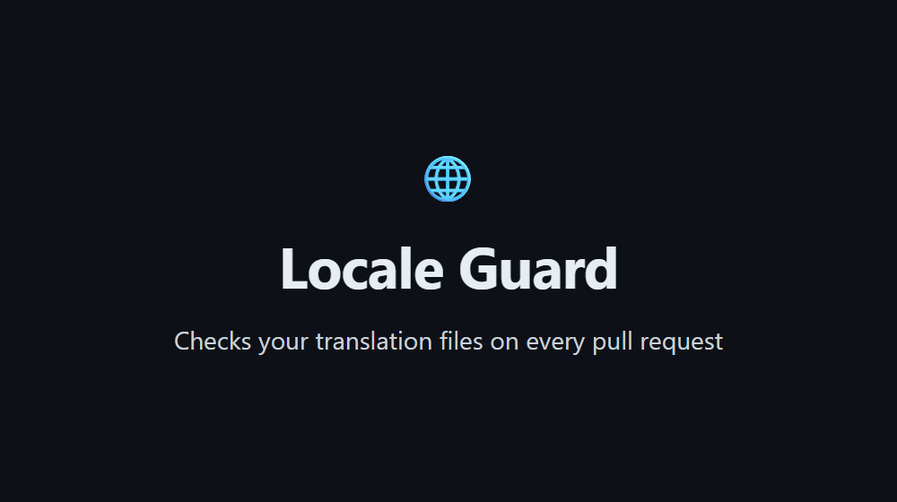
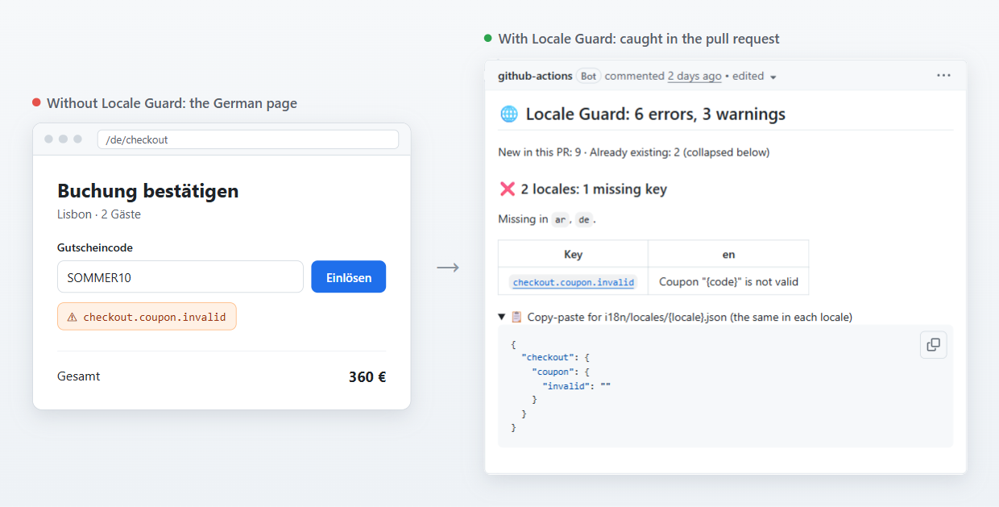
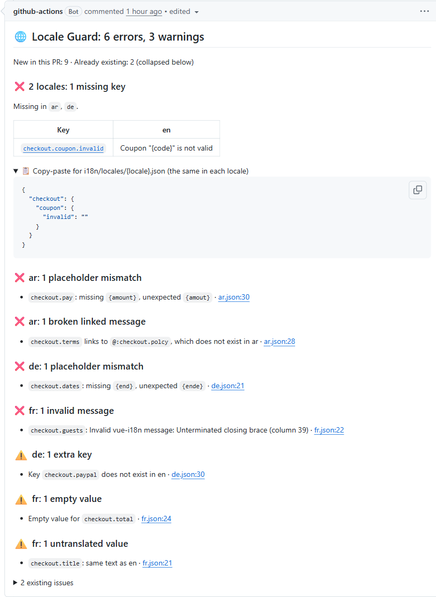
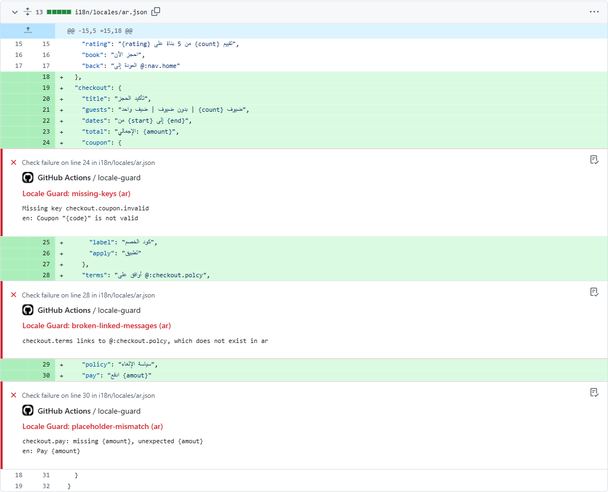
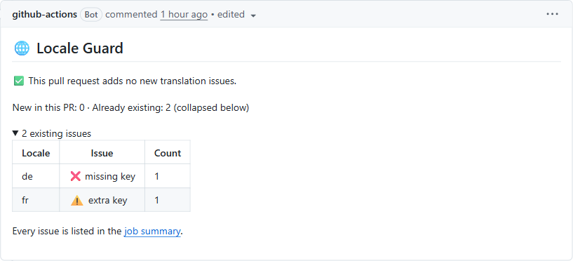
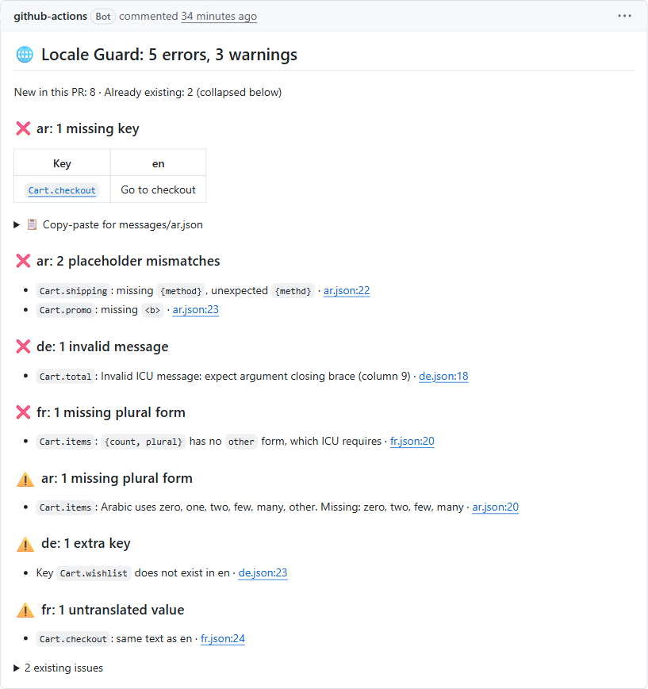
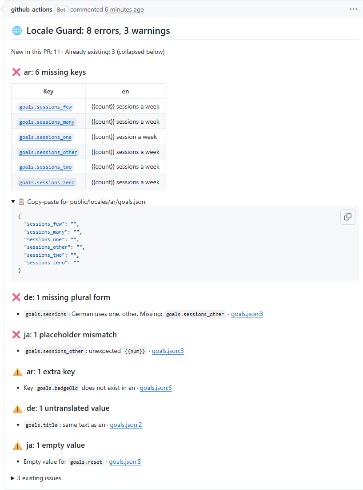

# Locale Guard

[](https://github.com/Mohamed-Almarag/locale-guard/actions/workflows/ci.yml)
[](https://github.com/Mohamed-Almarag/locale-guard/releases)
[](LICENSE)

A GitHub Action that checks your translation files on every pull request, and
tells you exactly what is missing or broken in each language before it reaches
your users.

It works with **vue-i18n** (and Nuxt), **ICU** messages (next-intl, react-intl)
and **plain JSON** (i18next, react-i18next), in JSON or YAML files.





A key added to English and forgotten in German shows up like this in production.
Locale Guard catches it in the pull request instead.

## What you get

**One comment per pull request**, updated on every push, with each problem, the
English text to translate, and a block of the missing keys ready to paste into
each file:



**Annotations on the exact line** in the "Files changed" tab:



**Only the issues the pull request adds** fail the check. Issues that were
already on the base branch are counted apart and collapsed, so you can add
Locale Guard to a project that already has hundreds of them. When a push fixes
everything, the same comment turns green:



A pull request that never adds an issue gets no comment at all. A full report
also goes to the job summary of each run.

## Quick start

Add `.github/workflows/translations.yml`:

```yaml
name: Translations

on: pull_request

permissions:
  contents: read
  pull-requests: write

jobs:
  locale-guard:
    runs-on: ubuntu-latest
    steps:
      - uses: actions/checkout@v7
      - uses: Mohamed-Almarag/locale-guard@v1
        with:
          files: locales/{locale}.json
          format: vue-i18n
```

`files` says where your locale files are, with `{locale}` where the language
code goes. `format` names the library that reads your messages. That is all most
projects need.

## Checks

| Check                    | Severity | What it finds                                                                                                                                    |
| ------------------------ | -------- | ------------------------------------------------------------------------------------------------------------------------------------------------ |
| `missing-keys`           | error    | A key in the base locale that another locale does not have                                                                                       |
| `placeholder-mismatch`   | error    | Placeholders, ICU arguments or rich text tags that differ from the base message: `{amout}` instead of `{amount}`, a missing `<b>`                |
| `invalid-syntax`         | error    | A message the library cannot compile, such as an unclosed brace                                                                                  |
| `broken-linked-messages` | error    | A vue-i18n link like `@:common.save` to a key that does not exist                                                                                |
| `parse-error`            | error    | A file that is not valid JSON or YAML                                                                                                            |
| `plural-forms`           | warning  | A plural that misses forms the language needs (Arabic uses six). A missing `other` form is an error                                              |
| `extra-keys`             | warning  | A key that is not in the base locale, usually removed or misspelled                                                                              |
| `empty-values`           | warning  | A value that is empty or only spaces                                                                                                             |
| `untranslated`           | warning  | Text identical to the base, text with no letter of the language's script (English left in an Arabic file), and values copied between two locales |

Plural forms come from `Intl.PluralRules`, so every language works without
tables: English needs `one` and `other`, Arabic needs `zero`, `one`, `two`,
`few`, `many` and `other`, and Japanese needs only `other`. In Rails YAML files,
a key whose children are only plural forms (`count.one`, `count.other`) is
checked the same way, which matches the rules of
[rails-i18n](https://github.com/svenfuchs/rails-i18n).

## Formats

Set `format` to the name of your translation library:

| Library                                           | `format`        | Message syntax                                                 |
| ------------------------------------------------- | --------------- | -------------------------------------------------------------- |
| vue-i18n                                          | `vue-i18n`      | `{name}`, `{0}`, `@:linked.key`, plurals with `\|`             |
| @nuxtjs/i18n                                      | `@nuxtjs/i18n`  | Same as vue-i18n                                               |
| next-intl, use-intl                               | `next-intl`     | ICU: `{count, plural, ...}`, `{x, select, ...}`, `<b>tags</b>` |
| react-intl, FormatJS                              | `react-intl`    | ICU                                                            |
| i18next, react-i18next, next-i18next, i18next-vue | `react-i18next` | `{{name}}`, plurals as `key_one`, `key_other`                  |
| Rails I18n                                        | `json`          | `%{name}`, plurals as `key.one`, `key.other`                   |
| Anything else                                     | `json`          | `{name}` and `{{name}}`                                        |

The names that share a syntax do the same thing, so `icu`, `next-intl` and
`react-intl` are interchangeable. A framework name like `nuxt` or `react` is not
accepted, because each framework can use libraries with different syntax; the
error message lists the libraries to choose from.

## Locale files

`files` takes one or more patterns, one per line:

| Layout                                          | `files`                      |
| ----------------------------------------------- | ---------------------------- |
| One file per language                           | `locales/{locale}.json`      |
| One folder per language, one file per namespace | `locales/{locale}/*.json`    |
| Nested namespaces                               | `locales/{locale}/**/*.json` |
| YAML                                            | `locales/{locale}.yml`       |

Keys can be nested (`{ "cart": { "title": "Cart" } }`) or flat
(`{ "cart.title": "Cart" }`). The copy-paste block follows whichever way the
base file writes each key.

### Rails

Rails wraps each file in its locale key (`en:` at the top of `en.yml`) and
merges every file of a language into one tree. Give both patterns:

```yaml
files: |
  config/locales/{locale}.yml
  config/locales/*.{locale}.yml
format: json
```

Locale Guard reads the locale key as the wrapper, so
`en: { cart: { title: … } }` is the key `cart.title`. A key missing from
`devise.ar.yml` is placed in that file, and the copy-paste block puts the locale
key back on top.

### A base file without a locale code

Some projects name the base file without its locale, such as `lang/main.json`
next to `lang/main-ar.json` and `lang/main-fr.json`. No `{locale}` pattern
matches it, so name it with `base-file`:

```yaml
files: lang/main-{locale}.json
base-file: lang/main.json
```

A pull request that changes only the base file is checked too.

## Inputs

| Input              | Default               | Description                                                                                                                                                                                 |
| ------------------ | --------------------- | ------------------------------------------------------------------------------------------------------------------------------------------------------------------------------------------- |
| `files`            |                       | **Required**, here or in the settings file. Where the locale files are, with `{locale}` in place of the language code. Several patterns can be given, one per line.                         |
| `format`           | `json`                | The library that reads your messages. See [Formats](#formats).                                                                                                                              |
| `base-locale`      | `en`                  | The locale every other locale is compared with.                                                                                                                                             |
| `base-file`        |                       | The base locale's file when its name has no locale code, such as `lang/main.json` next to `lang/main-ar.json`. See [A base file without a locale code](#a-base-file-without-a-locale-code). |
| `fail-on`          | `error`               | When the check fails: `error`, `warning` or `never`.                                                                                                                                        |
| `fail-on-existing` | `false`               | Also fail on issues that existed before the pull request.                                                                                                                                   |
| `check-when`       | `locale-changes`      | `locale-changes` checks only pull requests that change locale files. `always` checks every pull request and lists the existing issues, which fail only with `fail-on-existing: true`.       |
| `comment`          | `true`                | Write a single pull request comment that is updated on every run.                                                                                                                           |
| `annotations`      | `true`                | Mark issues on their line in the "Files changed" tab.                                                                                                                                       |
| `ignore-keys`      |                       | Key patterns to skip, one per line or comma separated, such as `legacy.*`. Namespaces are part of the key: `billing.*` skips `locales/{locale}/billing.json`.                               |
| `ignore-locales`   |                       | Locales to skip, such as a language that is still being translated.                                                                                                                         |
| `ignore-values`    |                       | Values that may stay untranslated, such as brand names: `Google`, `OK`. One per line, and a line can contain commas. Matched against the whole value, ignoring case.                        |
| `disable-checks`   |                       | Checks to turn off, by the names in [Checks](#checks).                                                                                                                                      |
| `config-file`      | `.localeguard.yml`    | Optional settings file.                                                                                                                                                                     |
| `github-token`     | `${{ github.token }}` | Token used to read the pull request and write the comment.                                                                                                                                  |

### Settings file

The same settings can live in `.localeguard.yml` at the root of the repository.
Inputs set in the workflow win over the file.

```yaml
files: messages/{locale}/*.json
format: next-intl
base-locale: en
fail-on: error
ignore-locales:
  - he
ignore-values:
  - Google
  - Visa, Mastercard, Amex
  - XL
disable-checks:
  - extra-keys
```

A wrong setting fails the run with a message that names it, such as
`Invalid "fail-on": expected one of error, warning, never (got "errors")`.

## New and existing issues

On a pull request, Locale Guard checks the base branch too and compares the two.
An issue counts as existing when the same check finds the same problem on the
same key in the same locale, so moving a key or editing lines above it does not
make it new.

- The comment lists new issues and collapses existing ones into a count per
  locale.
- The job summary lists every issue.
- Only new issues are annotated and fail the check, unless
  `fail-on-existing: true`.
- With `check-when: always`, every pull request is checked and the comment lists
  the existing issues open, so old problems stay in sight.

The base branch is read through the GitHub API, so `actions/checkout` does not
need `fetch-depth: 0`. By default, a pull request that changes no locale file
and no settings file finishes in a few seconds without checking anything.

### Full report on a schedule

To list every issue in the project outside pull requests, run Locale Guard
weekly or by hand. It writes the full report to the job summary and fails when
it finds errors.

```yaml
on:
  schedule:
    - cron: '0 6 * * 1'
  workflow_dispatch:
```

## Forks and security

A pull request from a fork gets a read-only token, so Locale Guard cannot write
the comment. It does not fail because of that: the results go to the job summary
and the annotations, and the log says why there is no comment.

<!-- prettier-ignore-start -->
> [!WARNING]
> Do not switch to `pull_request_target` to get the comment on fork pull
> requests if the workflow checks out the pull request's code. That trigger runs
> with a write token and your secrets, and checking out code from a fork with it
> lets anyone who opens a pull request run code with those permissions. Keep
> `pull_request`. See GitHub Security Lab's
> [Preventing pwn requests](https://securitylab.github.com/resources/github-actions-preventing-pwn-requests/).
<!-- prettier-ignore-end -->

The workflow needs only these permissions:

```yaml
permissions:
  contents: read # read the locale files of the base branch
  pull-requests: write # write the comment
```

Without `pull-requests: write`, Locale Guard skips the comment, says why in the
log, and still writes the job summary and the annotations.

## Examples

Each demo is a small app with three open pull requests: one with mistakes on
purpose, one that is fixed by a second commit, and one that does not touch
translations.

| Stack                             | Repository                                                                                                |
| --------------------------------- | --------------------------------------------------------------------------------------------------------- |
| Nuxt with `@nuxtjs/i18n`          | [locale-guard-demo-nuxt](https://github.com/Mohamed-Almarag/locale-guard-demo-nuxt)                       |
| Vue with YAML files               | [locale-guard-demo-vue-yaml](https://github.com/Mohamed-Almarag/locale-guard-demo-vue-yaml)               |
| Vue with namespace files          | [locale-guard-demo-vue-namespaces](https://github.com/Mohamed-Almarag/locale-guard-demo-vue-namespaces)   |
| Next.js with next-intl            | [locale-guard-demo-next](https://github.com/Mohamed-Almarag/locale-guard-demo-next)                       |
| Next.js with namespace files      | [locale-guard-demo-next-namespaces](https://github.com/Mohamed-Almarag/locale-guard-demo-next-namespaces) |
| React with react-intl             | [locale-guard-demo-react-intl](https://github.com/Mohamed-Almarag/locale-guard-demo-react-intl)           |
| React with react-i18next          | [locale-guard-demo-react-i18next](https://github.com/Mohamed-Almarag/locale-guard-demo-react-i18next)     |
| Rails with YAML files             | [locale-guard-demo-rails](https://github.com/Mohamed-Almarag/locale-guard-demo-rails)                     |
| A base file without a locale code | [locale-guard-demo-base-file](https://github.com/Mohamed-Almarag/locale-guard-demo-base-file)             |

ICU messages: plurals, a `select` argument and rich text tags.



i18next plural keys: Arabic gets the six forms it needs, German misses `_other`,
and Japanese, which needs only `_other`, is not asked for `_one`.



## Tested on real projects

Before the first release, Locale Guard ran on five real projects built with Vue,
Nuxt and Next.js, in JSON and YAML. The largest had 70 locales of about 3,000
keys each, and was checked in about 8 seconds on a laptop. Among the issues it
found were placeholders with typos (`{fotmat}`, `{Count}`), a stray brace that
breaks a message, and values copied from one language's file into another's.

## Limits

- GitHub shows at most 10 error and 10 warning annotations per step. Locale
  Guard annotates new errors first and counts the rest in one notice. Every
  issue is in the job summary.
- A comment can hold about 65,000 characters. A longer report is cut, and the
  comment links to the job summary for the rest.
- vue-i18n plurals (`one | many`) are not checked for missing forms, because
  their number of branches depends on custom rules.
- Plural forms nested under a key in JSON
  (`{ "items": { "one": …, "other": … } }`) are read as ordinary keys, because
  each library that writes them has its own plural rules. They are checked as
  plurals only in Rails YAML files.
- Locale Guard does not know which keys your code uses, so it does not report
  unused keys or keys that the code uses but no file defines.

## Contributing

Bug reports and false positives are welcome. Read
[CONTRIBUTING.md](CONTRIBUTING.md) before opening a pull request, and report
security issues privately as described in [SECURITY.md](SECURITY.md).

## License

[MIT](LICENSE)

---

<p align="center" dir="rtl">
  ﴿ مَا مَكَّنِّي فِيهِ رَبِّي خَيْرٌ ﴾
</p>

<p align="center">
  <em>"What my Lord has granted me is better."</em><br>
  <sub>Qur'an, Al-Kahf 18:95</sub>
</p>
